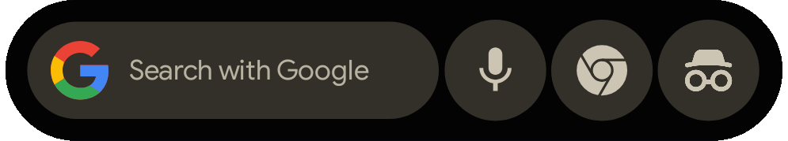

# MySearchWidget

> [!NOTE]
> **L'intero progetto è stato realizzato in vibe coding. In questo repository non esiste codice scritto da un umano.**

[English](README.md) · **Italiano** · [Scarica l’APK](https://github.com/alessio89g/MySearchWidget/releases)

Un widget di ricerca per Android ispirato all’aspetto della barra di **Google Circle to Search**. Personalizza ricerca, azioni e grafica con un configuratore **Material 3 Expressive** e un’anteprima dal vivo. Ogni widget ha impostazioni indipendenti.

## Per iniziare

Richiede **Android 12 o successivo** e un launcher compatibile con i widget.

1. Installa l’APK dalla sezione [Releases](https://github.com/alessio89g/MySearchWidget/releases).
2. Apri l’app e premi **Aggiungi widget**, oppure usa il selettore widget del launcher.
3. Conferma il posizionamento, personalizza il widget e premi **Salva**.

Per modificarlo, selezionalo nella home dell’app o apri la configurazione dal launcher. La **casetta** accanto a Salva riporta alla home dell’app. Le modifiche restano in anteprima fino al salvataggio; prima di scartarle viene chiesta conferma.

L’interfaccia parte in inglese: il pulsante **EN / IT** cambia lingua immediatamente e ricorda la scelta.

## Cosa puoi personalizzare

| Sezione | Controlli |
| --- | --- |
| **Layout** | Altezza e larghezza, spaziature, posizione di ogni elemento con frecce o valori numerici, proporzioni bloccabili, collegamenti degli spostamenti e ordine dei livelli. Da **0 a 3 pulsanti**. |
| **Aspetto** | Tema chiaro, scuro o di sistema; Material You; colori, opacità e gradienti a due colori con direzione libera; forme dei pulsanti; icone integrate, icone delle app, icon pack o immagini importate, monocromatiche o nei colori originali. |
| **Azioni** | Azioni predefinite, apertura di app e scorciatoie per logo e pulsanti. Feedback aptico separato per campo di ricerca, logo e ciascun pulsante, attivo di default. |
| **Ricerca** | Motori integrati o personalizzati, ricerca tramite app Google, testo a riposo e stile del testo digitato. |
| **Legami** | Impostazioni condivise oppure separate tra modalità chiara e scura, per elemento e funzione. |
| **Backup** | Esportazione delle configurazioni e importazione come modelli riutilizzabili, inclusi font e immagini. |

**Aspetto.** I pulsanti possono avere forma cerchio/quadrato, squircle, fiore, clover, leaf, pebble, scallop o teardrop. Il selettore colori combina area grafica, slider, codici HEX/RGB e preset.

Per logo e pulsanti puoi scegliere icone integrate, immagini, icone originali delle app o icon pack. Scegliendo un pack compatibile si apre il suo selettore; in alternativa puoi sfogliarne il catalogo disponibile nell’app. Le personalizzazioni private del launcher non vengono lette automaticamente: scegli lo stesso pack e la stessa icona per riprodurle.

Outline, tinta monocromatica e gradienti si applicano anche alle icone importate. La modalità monocromatica conserva i contrasti; **Mantieni contorno esterno**, disattivato di default, permette di includere il bordo dello sfondo nell’outline. Quando escluso, viene rimosso lo sfondo uniforme riconoscibile; i simboli già trasparenti conservano il proprio contorno. Le tinte manuali richiedono Material You disattivato e modalità monocromatica attiva.

**Azioni.** Le scorciatoie sono raggruppate per app. Per quelle dinamiche puoi usare l’accesso temporaneo come app Home: seleziona e salva la scorciatoia, poi premi **Ripristina il launcher**. Le scorciatoie fissate restano utilizzabili; dopo una reinstallazione o un cambio di dispositivo può essere necessario selezionarle nuovamente. La disponibilità dipende dalle app installate.

Quando scegli un’app o una scorciatoia, **Icona per questa azione** permette di mantenere l’icona attuale, usare quella dell’app o sceglierla da un pack. L’icona segue il proprio legame chiaro/scuro, indipendentemente da quello dell’azione.

**Ricerca.** Per il testo sono disponibili font importabili, dimensione, peso, grassetto, corsivo, sottolineatura, barrato, colori e gradienti. Puoi formattare singole porzioni del testo a riposo con l’editor visuale o **BBCode**; lo stile della query si applica invece a tutto il testo digitato.

L’anteprima può mostrare un fondo solido o il wallpaper e alternare chiaro/scuro. **Annulla/Ripeti** ripercorre le modifiche. I comandi **Ripristina** agiscono sulle singole opzioni usando i valori predefiniti della versione installata, senza modificare automaticamente i widget già salvati.

## Come si comporta il widget

- **Configurazione iniziale:** altezza di 68 dp, tema di sistema, logo Google a colori e tre pulsanti per ricerca vocale, Chrome e navigazione in incognito. Material You e apertura della ricerca nell’app Google sono disattivati.
- **Testo automatico:** lasciando vuoto il testo a riposo compare “Cerca con…” seguito dal motore selezionato, anche personalizzato. Un testo inserito manualmente resta invariato; il cambio di motore conserva la formattazione.
- **Ricerca:** la query viene inviata al motore scelto nel browser. In alternativa, il tocco del campo apre la ricerca nell’app Google; in questo caso i controlli dei motori sono disabilitati, ma le impostazioni vengono conservate.
- **Colori:** Material You disabilita i controlli manuali di colori e gradienti. Le icone nei colori originali ignorano la tinta personalizzata. Le scelte manuali restano memorizzate.
- **Chiaro/scuro:** le impostazioni sono condivise per default, tranne colori e gradienti. In **Legami** puoi separarle; il configuratore indica quale modalità stai modificando.
- **Ridimensionamento:** restringendo il widget, il campo di ricerca si adatta alla larghezza disponibile mantenendo altezza e margini, salvo personalizzazioni. Gli elementi possono sovrapporsi o uscire dall’area visibile. Se il launcher assegna spazio verticale insufficiente, l’intera composizione viene ridotta.

## Backup

Il backup è un unico file JSON che incorpora le impostazioni, i font importati e le immagini utilizzate. Non occorre conservare file separati né mantenere installato l’icon pack. Il wallpaper non è incluso; le app associate alle azioni devono essere installate per poterle aprire.

I backup importati diventano **modelli**: applicarli a un widget è un passaggio distinto. Un tocco prolungato su widget o modelli attiva la selezione multipla; il **cestino in alto a destra** richiede conferma. Elimina i modelli selezionati, mentre nasconde le voci dei widget senza rimuoverli dalla Home né cancellarne le impostazioni. Per rimuovere un widget dalla Home usa il launcher.

## Aggiornamenti e permessi

Il configuratore controlla le release GitHub all’apertura e propone download diretto e installazione dell’APK, verificandone pacchetto, versione e firma. Non esegue controlli periodici né mantiene servizi permanenti in background. La configurazione è utilizzabile offline.

L’anteprima del wallpaper è opzionale e può richiedere accesso alle immagini o a tutti i file, secondo il sistema. Senza accesso resta il fondo solido; il wallpaper non viene incluso nei backup. Android può inoltre richiedere l’autorizzazione a installare gli aggiornamenti. Ricerche e azioni vocali sono gestite dalle app esterne; MySearchWidget non richiede il permesso microfono.

Dimensioni, scorciatoie e apertura della ricerca Google dipendono anche dal launcher e dalle app installate. **Il progetto non è affiliato a Google e non implementa Circle to Search.**

## Sorgenti e licenza

Consulta le [istruzioni di compilazione](docs/BUILD.md), le [verifiche eseguite](docs/TESTING.md) e il [changelog](CHANGELOG.md).

La [MySearchWidget Non-Commercial Source-Available License 1.1](LICENSE) consente uso, modifica, fork e ridistribuzione **non commerciali**:

- Ogni ridistribuzione deve conservare licenza e avvisi e citare il [repository originale](https://github.com/alessio89g/MySearchWidget) nei crediti.
- Per versioni **non modificate**, il collegamento nei crediti basta: non è richiesta la consegna dei sorgenti.
- Per versioni **modificate**, occorre distribuire anche i sorgenti completi corrispondenti e le istruzioni di build, mantenere la stessa licenza e documentare le modifiche.

Fa fede il testo completo della licenza. Font, icone e altre risorse di terzi mantengono le proprie licenze: vedi [Crediti](CREDITS.md).
