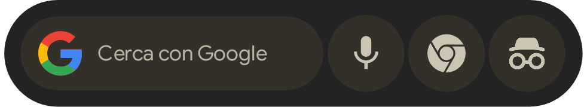

# MySearchWidget

> [!NOTE]
> **The entire project was created using vibe coding. There is no human-written code in this repository.**

**A customizable Android search widget with Material You colors, gradients, rich text and shortcuts to your apps.**

**English** · [Italiano](README.it.md)

Inspired by the appearance of the **Google Circle to Search** bar, MySearchWidget lets you create independent widgets and configure them through a **Material 3 Expressive** interface with a live preview.



## Features

### Search and actions

- Type your query in the widget and send it to your default browser using your chosen search engine.
- Alternatively, tap the search field to open search in the Google app.
- Choose a built-in search engine or add custom engines.
- Assign actions to the left logo and **0, 1, 2 or 3 buttons** on the right: built-in actions, app launches or shortcuts grouped by app.
- Add multiple widgets to your home screen, each with its own appearance and actions.

### Appearance

- **Widget height:** set a value from 16 to 256 dp, including decimals, in **Layout**. The default height and height reset are **68 dp**. In automatic mode, element sizes follow the overall height. Narrowing the widget shortens the search field without reducing its height. Resize the widget vertically on the Home screen to provide room for greater heights.
- **Independent dimensions and spacing:** set the outer capsule and search-field widths, search-field height, logo and icon sizes, each button background’s width and height, side padding, logo/text spacing and the gap before each button. Element dimension and spacing controls accept a manual dp value or automatic sizing. Restore automatic sizing to follow the overall widget height. Elements resize around fixed centers without moving neighbouring elements. The logo and text follow the search field while their movement link is enabled. Oversized elements fit the widget bounds; large sizes can overlap.
- **Element positioning:** the **Layout** tab in the bottom navigation groups position, size and spacing controls. Adjust X/Y offsets in dp using numeric fields or arrows with a custom step; elements can overlap or move outside the visible area. Reset position restores the selected element’s initial offset.
- **Separate resets:** each element in Layout has **Reset default dimensions** and **Reset default position**. Each restores the selected element’s initial preset values: outer height 68 dp, search field 193 × 47 dp at a 374 dp reference width, placeholder 12.5 sp and query text 15 sp. Lock settings are retained and positions are relative to the parent when linked.
- **Layer order:** in **Layout → Layer order**, the top of the list is the foreground. Arrows move each element above or below the others; stacking is independent of movement links and is included in backups.
- **Movement links:** padlocks link the logo and text to the search field, and each icon to its button, by default. Moving the parent moves its linked children; moving a child leaves other elements in place. Linking or unlinking preserves the current position.
- **Lock proportions:** the padlock and connector lines next to width and height link the two dimensions for the outer capsule, search field and each button. The initial preset locks the outer capsule and buttons; the search field can be resized independently. Locking keeps the current ratio; unlocking allows independent changes. The setting is saved per element and included in backups.
- **Material You:** use the system’s dynamic color palette.
- **Custom colors and gradients:** customize the outer capsule, search field, logo, each button background and its icon, with separate values for light and dark themes.
- Choose colors with a graphical picker, sliders, HEX/RGB codes and presets. Gradients have two colors and a direction adjustable visually or in degrees.
- Adjust background opacity and corner rounding. Button shapes include circle/square, squircle, flower, clover, leaf, pebble, scallop and teardrop.
- Choose built-in icons or import images. Each logo/button has a **Monochrome icon** switch. The initial preset uses the Google logo’s original colors and monochrome action icons. Turn it off to preserve imported image colors and transparency, or use the native colors of the Google and Chrome symbols. Material symbols are naturally single-color.
- Original icon colors take precedence over Material You for that icon only. Manual tint and gradient controls are disabled while original colors are active; saved values return when you switch back to monochrome.
- Preview the widget on a solid background or a center crop of your home screen wallpaper.

### Text

- Customize the **placeholder**, the text displayed before typing: font, size, weight, bold, italic, underline, strikethrough, colors and gradients.
- Format the entire placeholder or a selected range of text.
- Configure the query style separately: it applies to all typed text.
- Use the visual editor or **BBCode** mode.
- The bundled font is **Google Sans Regular 14.000**, licensed under [SIL OFL 1.1](LICENSE-Google-Sans.txt); additional TTF, TTC and OTF fonts can be imported.

### Configuration and backup

- **Layout → Number of buttons** lets you show 0 to 3 buttons. Hidden buttons retain their settings and become available again when you increase the number.
- Six sections: **Layout, Appearance, Actions, Search, Light/Dark linking and Backup**. Layout is the first section and opens when you start configuring a widget.
- Settings use **grouped cards** with an icon, title and description. Tap a row to open its controls; **All settings** or Back returns to the section list.
- Each element in Layout has **Dimensions** and **Position** panels with their respective resets. Each area in Actions groups its tap action and haptic feedback.
- Material 3 Expressive selectors show frequent choices directly and wrap on narrower screens. Preview background settings open from the row below the preview.
- A GitHub link with the GitHub logo at the bottom of the home screen opens the project repository.
- English and Italian interfaces, with instant switching through **EN / IT** in the top-right corner and a persistent language preference.
- Export and import individual widget configurations, including layout, layer order, movement links, imported fonts and images.
- A library of reusable templates. Backups are validated before import; applying one to a widget is a separate step that requires confirmation.

Changing the button count lets the search field’s automatic width fill the available space without changing its height. Buttons align to the right with uniform outer insets; with no buttons, the field has symmetric insets. Manual dimensions, spacing and offsets remain customizable.

The global height control changes height while retaining the current width. New widgets start at 68 dp, adapting horizontally to the launcher. If the launcher allocation limits the displayed height, the preview reports it.

## Light/Dark linking

**Light/Dark linking**, opened from **Links** with the padlock after **Search**, lets you choose which settings to share between the two modes. Each element has individual switches for dimensions, position, stacking order, colors and gradients. Separate controls also cover the search engine, Google app search, logo, shapes, button count and icons, placeholder content, fonts, formatting and actions.

Separation switches are **off by default**, except for **colors and gradients**, which keep distinct values. With a switch off, edits apply to both modes; with it on, only the selected mode changes. When turning it off, if values differ, choose whether to keep the light or dark values for both modes. Manual colors still require **Material You to be off**, using its control in Appearance.

**Editing mode**, beside the preview, appears in sections with separate settings and selects the mode you are editing. The preview follows this selection and can also be switched independently. Section notices indicate whether settings are shared or separate. **Undo/Redo** includes linking changes; **Save** applies the entire configuration. Backups preserve both modes and their custom search engines.

## Updates

When the configurator opens, it checks GitHub for a newer stable release and offers to download the APK directly, without a browser or WebView. Android manages the download, and the app offers installation when it finishes. If the configurator was closed, the offer appears when it is reopened. Android may ask you to allow installations from MySearchWidget; the button opens the relevant settings screen.

The package, version code and APK signature are checked before installation. The app has no periodic update checks, background services or permanent background processes. The configurator remains usable without a network connection.

## Managing the list and trash button

Long-press a widget or an imported template to enter selection mode. Tap other items to select them together, then use the **trash button in the top-right corner** and confirm. **Cancel** or the Back button exits selection without removing anything.

- **Imported templates:** are deleted from the library; widgets using them keep their settings.
- **Widgets:** the entry is hidden from the list while the Home widget keeps its settings. Use your launcher to remove the widget from the Home screen. Opening its configuration again from the launcher and saving it makes the entry visible in the list again.

## Download

Download the APK and its corresponding source archive from [Releases](https://github.com/alessio89g/MySearchWidget/releases). Each release also includes SHA-256 checksums.

To build the project, see the [build instructions](docs/BUILD.md). Check results and their scope are documented in the [validation notes](docs/TESTING.md).

## Requirements and getting started

- **Android 12 or later** and a launcher that supports widgets.
- A browser for web searches; the Google app for features that require it.

1. Install the MySearchWidget APK, allowing installation from that source if Android requests it.
2. On the app’s home screen, choose **Add widget** to place a new widget on your home screen. You can also use your launcher’s widget picker.
3. Confirm placement in your launcher. The configurator opens for the new widget: customize it and tap **Save**. To edit an existing widget, select it on the app’s home screen.
4. Tap the search field to start searching, or use the logo and buttons for their assigned actions.

Edits and applied templates remain in the preview until you tap **Save**. **Cancel** lets you leave and discard edits after confirmation. Back first returns to the section list; from the main configuration screen, it lets you leave with the same confirmation.

For widgets already placed on the home screen, the preview uses the dimensions reported by the launcher and scales the complete composition to fit the configurator. Element positions are not recalculated from the width of the preview card.

When the widget becomes narrower or wider in the launcher, the search field adjusts its width and the buttons stay aligned to the right. Height and spacing from the outer outline remain unchanged, respecting custom offsets. If the launcher provides insufficient vertical space, the composition scales down to fit. The preview and touch targets follow the same layout.

**Undo** and **Redo** step through edits before saving; a slider drag is one edit. The **Light/Dark** preview button shows its current state and changes only the preview. Choosing a colour variant automatically previews that variant, and you can still switch it manually.

**Haptic feedback** is enabled by default and can be toggled independently in **Actions** for the search field, logo and each action button. A button and its icon share one setting. Feedback respects Android’s touch-vibration settings.

The initial language is **English**. Tap **EN** to switch to Italian. The automatic placeholder follows the selected engine: **“Search with Bing” / “Cerca con Bing”**, including custom engines such as Qwant. Formatting is preserved. A custom placeholder takes precedence and is not translated or replaced when the engine changes. Google-app search uses Google in the automatic placeholder.

> The APK is signed with a **debug key**. Updating an existing installation requires a compatible signature.

## Initial settings and disabled controls

Existing saved widgets keep their settings; the preset applies to new widgets and explicit resets.

The default widget has a Google logo in its original colors and three buttons for voice search, Chrome and incognito browsing. Its rounded layout follows the appearance of Google Circle to Search.

| Option | Default for a new widget | Behavior |
| --- | --- | --- |
| Theme | Follow system | The widget follows Android’s light/dark mode. |
| Search field text | Cerca con Google | Edit it freely, or clear it to use the automatic search engine name. |
| Material You colors | Off | When enabled, manual color and gradient controls are greyed out and disabled. Turn this option off to customize them. |
| Open Google search when tapping the field | Off | When enabled, search engine management is greyed out and disabled because the Google app handles the search. |

**Your custom settings and saved search engines are not deleted.** They become available again when you turn off the corresponding option.

Google search opens its search interface; focus and keyboard behavior depend on the installed Google app version. The widget’s query styles do not change Google’s interface.

## Icon colors

In **Appearance → Logo** and **Appearance → Button N → Icon**, the **Monochrome icon** switch lets you choose between a customizable tint and the icon’s original colors. The initial preset uses original colors for the Google logo and monochrome icons for the buttons. Each element has its own setting.

With original colors, the image retains its own transparency and ignores tint, gradient and tint opacity. Material icons normally have a black source fill: monochrome mode lets you adapt them to the theme’s contrast.

## App shortcuts

The picker groups shortcuts by app and excludes apps without available entries. Some actions may be visible but disabled, with an explanation.

To access dynamic shortcuts published by apps:

1. In **Actions**, choose **Enable temporary access** and temporarily set MySearchWidget as your Home app.
2. Return to configuration, select **Shortcuts → app → action** and save.
3. Use **Restore your launcher** to switch back to your usual launcher.

This temporarily changes the actual default launcher; a recovery screen provides access to Home settings. Pinned shortcuts can still launch after restoring your previous launcher.

Availability depends on the shortcuts other apps actually publish and enable. After reinstalling or moving to another phone, dynamic shortcuts need to be selected and pinned again.

## Wallpaper and permissions

Wallpaper preview is optional. Reading the home screen wallpaper may require image access and, on some systems, special all-files access: the app offers this separately with an explanation.

If access is denied or the wallpaper cannot be read, for example with a live wallpaper, the preview keeps its solid background. The app does not scan your gallery or include the wallpaper in backups.

MySearchWidget uses **Internet access** to check GitHub releases and download requested updates. Permission to install apps is requested only when you choose to install an update. It does not request microphone or draw-over-other-apps access; online searches and voice actions are handled by the selected external apps.

## BBCode examples

A placeholder with partial formatting:

```text
[b]Search[/b] [gradient=#00C8FF,#00D99B,45]the web[/gradient]
```

A global query style:

```text
[b][i]{query}[/i][/b]
```

Available tags also include `[u]`, `[s]`, `[size=20]`, `[weight=500]`, `[font=default]` and `[color=#FF0000]`, with their corresponding closing tags. For queries, `{query}` must appear exactly once and have a single style. After editing, tap **Apply BBCode**. Custom colors require Material You to be turned off.

## Compatibility and limitations

- Widget size and placement also depend on your launcher’s grid and resizing behavior.
- Google actions and app shortcuts depend on installed apps and their versions.
- This is an independent project and is not affiliated with Google. Its visual inspiration does not imply support for Circle to Search.

## License and credits

The project's original code is distributed under the **MySearchWidget Non-Commercial Source-Available License 1.1**, a custom license. The complete, governing English text is available in [LICENSE](LICENSE).

- **Allowed:** non-commercial use, study, copying, modification, forks and non-commercial redistribution.
- **Prohibited:** commercial use, sale and exploitation of the software in commercial products or services, including advertising monetization.
- **Unmodified versions:** no source delivery is required; a link to the [original repository](https://github.com/alessio89g/MySearchWidget) in the credits is sufficient.
- **Modified versions:** redistribution must include the complete corresponding source code, including modifications and build instructions and scripts. A repository link alone is not sufficient.
- **Required credits:** both modified and unmodified redistributions must cite MySearchWidget and link to the original repository in their credits. See [CREDITS.md](CREDITS.md).
- **Same terms:** modified versions must retain this license, attribution notices and a description of changes. Modifications kept private do not need to be published.

The project is **source available for non-commercial use**, not open source under the [OSI definition](https://opensource.org/osd), which does not allow restrictions on commercial use.

Third-party assets are excluded from this license and retain their own terms: Material icons are distributed under [Apache 2.0](LICENSE-Material-Icons.txt); Google Sans is distributed under [SIL OFL 1.1](LICENSE-Google-Sans.txt); the GitHub mark from Octicons is distributed under [MIT](LICENSE-Octicons.txt). Trademarks and other third-party assets are not relicensed by this project.
